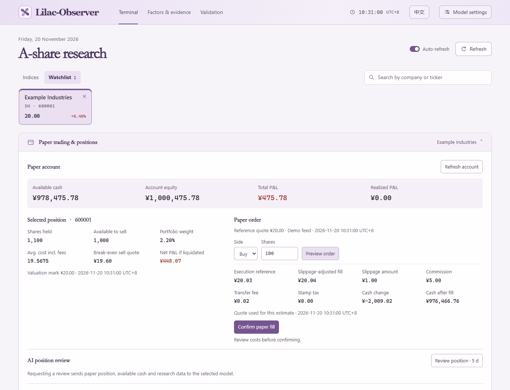

# Lilac-Observer

[简体中文](README.md) · English

**A local research terminal for China’s A-share indices and stocks, with a paper account and optional AI review.**

Search for a listed company or select one of six market indices. Inspect the price history, financial filings and news behind each forecast, then compare scenarios over 1, 5 or 20 trading sessions. For individual stocks, you can open a simulated long position and ask the model how the evidence relates to its cost, weight and sellable balance.

[Download v0.3.1](https://github.com/yukari-zhou/Lilac-Observer/releases/tag/v0.3.1) · [Changelog](CHANGELOG.md) · [Research methods and local API](docs/research.md)

*The screenshot uses synthetic data.*

## Start the terminal

Install Python 3.10 or newer. Download and extract the release or clone this repository. Start the app from the project folder.

| System | Command |
| --- | --- |
| Windows | Double-click `start.cmd` or run `.\start.cmd` in PowerShell |
| macOS / Linux | Run `bash start.sh` |

The launcher creates a virtual environment and opens the local service in your browser. Keep the terminal window open while using the service. Press Ctrl+C to stop it. Initial setup requires internet access to install dependencies and fetch market data. To upgrade, stop the old service, update the files in the same project folder and start it again. The default runtime folder preserves watchlists and model preferences.

Select English in the interface or use the English URL directly. Original company names, filings and news retain their source language. Search by a six-digit ticker, such as `600519`, to add a stock to the local watchlist. Quotes include their timestamps. Stock prices are quoted in RMB per share, and index levels are shown in points. [Open the English terminal](http://127.0.0.1:8765/?lang=en) · [Open the Chinese terminal](http://127.0.0.1:8765/?lang=zh)

## Paper trading

1. Select a stock from your watchlist and expand **A-share paper trading & position review**. All watchlist stocks share one local cash account, starting with **RMB 1,000,000**.
2. Choose Buy or Sell, enter the share quantity and select **Preview order**. Check the reference quote, simulated fill, slippage, itemized fees and cash change. Select **Confirm paper fill** to post it to your ledger. Purchases use available cash. Stock bought today becomes eligible for sale on the next trading day. Board-specific order sizes and sellable balances apply.
3. Check the position’s cost, current value, unrealized P&L and estimated P&L after liquidation. Under the stock’s strategy and risk section, expand **Trading cost scenario** to compare break-even and net P&L at the base forecast and at the risk threshold for an illustrative order.
4. To request a position review, select the review button for the current stock. The selected model receives the stock’s simulated position, sellable quantity, cost, weight, account cash and equity, together with the research packet. Ordinary market reviews use public market inputs. Position reviews run on explicit request, do not place orders and are kept separate from forecast validation.

Simulated execution requires a fresh quote and an opposing quote during continuous trading in Shanghai time, from 09:30 up to 11:30 and from 13:00 up to 14:57. For buys, the reference is the higher of the last price and best ask. For sells, it is the lower of the last price and best bid. Outside these windows, available quotes can still support cost previews. Orders are recorded locally without a brokerage connection.

| Cost | Simulation assumption |
| --- | --- |
| Commission | 0.025% on each side with a minimum of RMB 5 per order, including exchange handling and regulatory fees |
| Transfer fee | 0.001% on each side, charged separately in the simulation |
| Stamp duty | 0.05% on sales |
| Slippage | 0.05% adverse on each leg. The per-share adjustment is rounded to the nearest RMB 0.01, as is each fee component |

For example, buying and selling 100 shares with an unchanged reference quote of RMB 20.00 costs RMB 2,006.02 on entry and returns RMB 1,992.98 on exit, a net loss of RMB 13.04. Your broker’s commission agreement and fee inclusions may differ. The simulator does not reconstruct order-book queues, depth or partial fills. It does not book dividends, bonus shares or rights issues, so a holding spanning a corporate action can diverge from a brokerage statement. [Shanghai Stock Exchange fee guide](https://one.sse.com.cn/onething/gptz/) · [Example brokerage fee schedule](https://www.tpyzq.com/main/aboutus/xxgs/fyxxgs/index.shtml)

## Select a model

Open **Model settings**, choose the provider and save. The quantitative engine runs in Python in all three modes.

| Mode | Setup |
| --- | --- |
| Quantitative only | No account or API key required. Quotes, factors, scenarios, validation and the paper ledger still work |
| Codex CLI | Install the CLI and sign in. Leave the model blank to use the CLI default, or enter a model ID available to your account. Check access with `codex login status`. The desktop app can be closed |
| Compatible API | Enter the service base URL, model ID and API key. The endpoint must support non-streaming Chat Completions and a model capable of returning JSON. Remote endpoints require HTTPS. Local loopback endpoints may use HTTP |

For example, use `https://api.deepseek.com` with an available DeepSeek model ID, or `http://127.0.0.1:11434/v1` with the name of a locally installed model from `ollama list`. Cloud providers receive the research packet when enabled and charge according to your account terms. [DeepSeek API](https://api-docs.deepseek.com/) · [Ollama compatibility](https://docs.ollama.com/api/openai-compatibility) · [Codex CLI](https://developers.openai.com/codex/cli/)

Preferences saved through the UI take precedence over environment defaults. A key entered in the UI is stored as plaintext in the local settings file. To keep a key in process memory, provide it through the environment instead. Keys are scoped to the configured API base URL.

| Environment variable | Purpose |
| --- | --- |
| `LILAC_OBSERVER_PROVIDER` | `off`, `codex` or `api`. Without saved settings or an explicit environment setting, the app selects Codex when the CLI is available |
| `LILAC_OBSERVER_CODEX_MODEL` | Optional Codex model ID |
| `LILAC_OBSERVER_API_BASE_URL`, `LILAC_OBSERVER_API_MODEL`, `LILAC_OBSERVER_API_KEY` | Chat Completions endpoint, model ID and credential |
| `LILAC_OBSERVER_RUNTIME_DIR` | Local watchlist, settings, paper ledger and forecast records. Defaults to `.runtime/` |
| `LILAC_OBSERVER_CACHE_DIR` | Market data and security directory cache |
| `LILAC_OBSERVER_OFFLINE=1` | Use available cached data and disable AI review |
| `LILAC_OBSERVER_ENABLED=0` | Keep market data online and disable AI review |

Keep runtime files and credentials private when sharing a copy of the project. Existing installations can keep their environment settings. [Configuration compatibility](docs/research.md#配置兼容)

## Read a forecast

The forecast starts at the last completed daily close. It combines price factors with eligible financial reports, news, sector and macroeconomic evidence. Index fundamentals summarize covered constituents among the top 20 by weight. Company views use that company’s disclosures. Check the publication date, source and actual coverage before interpreting a signal.

Under validation, compare direction accuracy and mean absolute error with their baselines. Read interval coverage alongside sample count. A newly listed stock may have enough data to draw a chart but too few completed windows to support a directional forecast. The historical statistics measure price forecasts. The strategy’s illustrative round trip and the paper account calculate execution costs separately. Eligible ordinary reviews enter a local forward log and are checked against subsequent closes.

## Troubleshooting

| Symptom | What to check |
| --- | --- |
| The browser did not open | Open the local URL printed by the launcher. Check `/api/health`. For a port conflict, run `python app.py --open --port 8766` in the project environment |
| Search is empty, or quotes are cached or delayed | Check connectivity to the data source and the quote timestamp. A new installation needs an initial online fetch |
| There is a chart but no directional estimate | Check for at least 60 valid daily closes, a confirmed forward-adjustment basis and enough mature validation windows |
| Paper fills are unavailable | Read the reason beside the preview. Check continuous trading hours, the quote and opposing side, available cash, T+1 balance and board order sizes |
| AI review fails | Check CLI login, endpoint URL, model access, quota and JSON support. Save the corrected settings and refresh |

The results can support investment decisions. Forecasts and AI judgments can be wrong, and actual execution prices, costs and outcomes may differ from the simulation. Data sources have their own availability and redistribution terms. [Market data licensing](https://www.sseinfo.com/services/assortment/level1/) · [Index data licensing](https://www.cnindex.com.cn/zh_services/data_licensing/index.html?act_menu=4&act_service=3)
