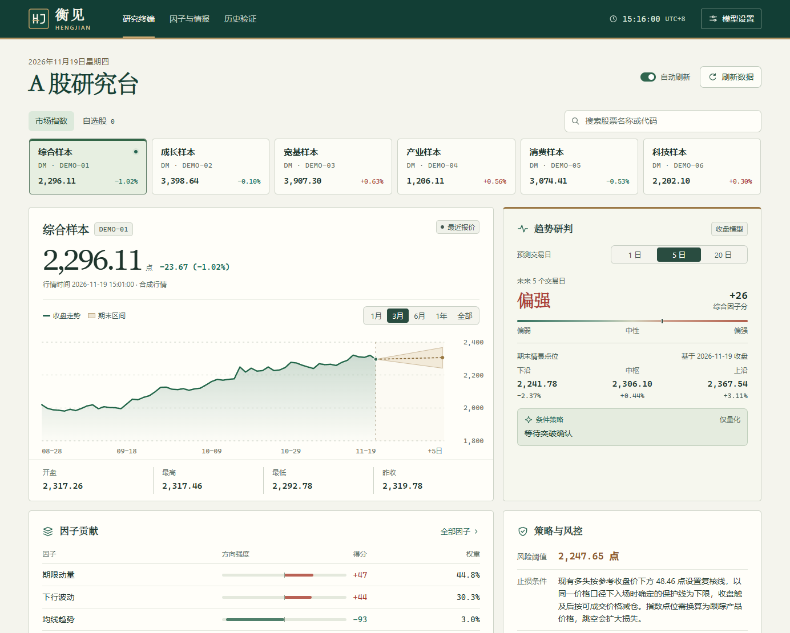

# Lilac-Observer

简体中文 · [English](README.en.md)

**A 股指数与个股研究台 · 行情、财报、模拟持仓与 AI 策略复核**

选择一个指数或上市公司，在本机查看价格走势、财报和公告，比较未来 1、5 或 20 个交易日的情景区间。每条策略给出触发条件、风险复核线和依据。Python 负责量化计算，证据复核可选 Codex CLI、兼容 API 或本机模型。

A local-first research terminal for China’s A-share indices and stocks, with financial filings, walk-forward evaluation and optional AI review.

[下载 v0.3.0](https://github.com/yukari-zhou/Lilac-Observer/releases/tag/v0.3.0) · [更新记录](CHANGELOG.md) · [研究方法](docs/research.md)

*界面示例，使用合成行情。*

## 启动

准备 Python 3.10 或更新版本，下载并解压仓库，或用 Git 克隆后进入项目目录。首次使用需要联网安装依赖并获取行情与证券目录。仓库只分发程序、文档和测试；行情缓存由每台机器分别建立。

| 系统 | 从项目目录启动 |
| --- | --- |
| Windows | 双击 `start.cmd`，或在 PowerShell 中运行 `.\start.cmd` |
| macOS / Linux | 在终端运行 `bash start.sh` |

脚本会准备 `.venv` 并启动本机服务。默认浏览器打开后，选择「市场指数」，查看沪深 300 等六个指数；也可在搜索框输入证券代码或公司简称，例如 `600519`，点击「加入自选」打开股价走势图。自选股会保留到下次启动。[打开本机研究台](http://127.0.0.1:8765/)

新启动的服务需要保留终端窗口，按 `Ctrl+C` 可停止。Windows 重复双击启动脚本时，若提示「研究台已经在运行」，可关闭这次打开的窗口。端口冲突时，在已安装依赖的虚拟环境中运行 `python app.py --open --port 8766`。

界面支持中文与英文。可直接用 `?lang=en` 打开英文界面，`?lang=zh` 切回中文。新闻、公告和公司原名保留来源语言。[打开英文本机界面](http://127.0.0.1:8765/?lang=en)

## 模拟交易与持仓

1. 在搜索框输入股票名称或代码，加入自选并打开该股。展开「模拟交易与持仓」。同一个本机账户供所有自选股使用，初始资金为 **100 万元人民币**。
2. 选择买入或卖出，填写股数，点击「预览成交」。核对模拟成交价、滑点、逐项税费和现金变动，再点击「确认模拟成交」。当日买入的股票从下一个交易日起可卖，卖出数量受可卖余额限制。
3. 在持仓中查看持股数量、成本、现金、已实现及浮动盈亏，比较保本卖出报价与计入平仓费用后的盈亏。个股「策略与风控」中的「交易成本测算」还提供一笔示例交易在预测中枢和保护位两种情景下的净盈亏。
4. 配好模型后，可在当前个股点选持仓复核，将该股模拟仓位摘要、账户现金与权益及研究证据发给所选模型。普通行情与策略复核使用公开市场数据。持仓复核独立于自动刷新，也不计入公开行情预测的前向验证。

模拟成交使用上海时间交易日连续竞价阶段 09:30 至 11:30 前、13:00 至 14:57 前的有效实时报价。买入取最新价与卖一价的较高值，卖出取最新价与买一价的较低值，再加入不利滑点。休市时可用已有报价测算。账本在本机保存，不连接券商下单。

| 成本 | 本项目的模拟口径 |
| --- | --- |
| 佣金 | 双向按成交额的 0.025%，每笔最低 5 元。假定佣金包含经手费与证管费 |
| 过户费 | 双向按成交额的 0.001% 单列 |
| 印花税 | 卖出按成交额的 0.05% |
| 滑点 | 买卖各按参考价的 0.05% 朝不利方向调整。每股调整量按 0.01 元四舍五入，各项税费分别取到分 |

费率采用统一模拟假设，券商合约可能采用不同的佣金及费用包含方式。例如，参考价均为 20.00 元时，一次买入再卖出 100 股，买入支出 2,006.02 元，卖出净回款 1,992.98 元，两笔合计亏损 13.04 元。模拟未重建盘口深度、排队与部分成交，也未自动处理分红、送转和配股。跨公司行动持有时，账面股数、成本和收益可能偏离实际账户。[上交所交易费用](https://one.sse.com.cn/onething/gptz/) · [券商收费公示示例](https://www.tpyzq.com/main/aboutus/xxgs/fyxxgs/index.shtml)

## 选择复核模型

打开右上角「模型设置」，选择接入方式，再点击「保存设置」。

| 方式 | 需要填写什么 | 如何确认 |
| --- | --- | --- |
| **仅量化** | 无 | 页面仍可更新行情、计算因子和查看历史验证，适合先熟悉研究方法 |
| **Codex CLI** | 安装并登录 Codex CLI。模型栏可留空，或填写账户有权使用的模型 ID | 在启动服务的终端运行 `codex login status`。复核通过命令行在后台完成，可关闭 Codex 桌面窗口 |
| **兼容 API** | 填写 API 地址、模型 ID、该服务的密钥。本机无鉴权服务可留空密钥 | 服务需支持非流式 `POST /chat/completions`，模型能按提示生成 JSON。界面显示复核状态与结果 |

**云端示例。** 使用 DeepSeek 时，可将 API 地址填为 `https://api.deepseek.com`，模型 ID 使用该账户当前可调用的名称，密钥使用对应服务签发的 API key。其他服务可填写形如 `https://服务域名/v1` 的基址，或完整的 Chat Completions 接口地址。需要适配专有协议的模型，可通过提供该兼容接口的网关接入。[DeepSeek 官方接入示例](https://api-docs.deepseek.com/) · [Codex CLI 安装说明](https://developers.openai.com/codex/cli/)

**本机示例。** 已经运行 Ollama 且已下载模型时，选择「兼容 API」，地址填写 `http://127.0.0.1:11434/v1`，模型 ID 填写 `ollama list` 中的完整名称。远程端点使用 HTTPS，本机回环地址支持 HTTP。[Ollama 兼容接口](https://docs.ollama.com/api/openai-compatibility)

开启云端复核时，服务会把当前标的、报价、量化结果与相关证据摘要提交给所选服务商。用量受自己账户的额度和计费规则约束。本机设置文件中的 API 密钥以明文保存，设置接口仅返回密钥状态。若希望密钥只存在于进程环境，可在启动前配置下表变量。

| 环境变量 | 含义 |
| --- | --- |
| `LILAC_OBSERVER_PROVIDER` | `off`、`codex` 或 `api`。首次启动且未指定时，有可用 Codex 命令则选 Codex，其余选仅量化 |
| `LILAC_OBSERVER_CODEX_MODEL` | 可选的 Codex 模型 ID |
| `LILAC_OBSERVER_API_BASE_URL`、`LILAC_OBSERVER_API_MODEL` | 兼容服务的基址和模型 ID |
| `LILAC_OBSERVER_API_KEY` | 启动进程使用的密钥，仅用于与环境配置匹配的 API 基址 |
| `LILAC_OBSERVER_RUNTIME_DIR` | 自选股、模拟账本、模型设置及研究留档的存储目录，默认 `.runtime/` |
| `LILAC_OBSERVER_CACHE_DIR` | 行情与证券目录缓存根目录 |
| `LILAC_OBSERVER_OFFLINE=1` | 关闭网络数据采集和 AI 复核，查阅已有缓存 |
| `LILAC_OBSERVER_ENABLED=0` | 关闭 AI 复核，保留在线行情与量化计算 |

从早期版本升级时，先停止已有服务，更新后在原目录启动即可沿用自选股与模型设置。原有的 `HENGJIAN_*` 变量和 `ASTRA_MODEL`、`ASTRA_CACHE_DIR`、`ASTRA_OFFLINE`、`ASTRA_ENABLED` 仍可使用。同一项同时设置新旧变量时，优先读取 `LILAC_OBSERVER_*`。页面已保存的模型设置优先于相应环境初值。

同一端点的密钥栏留空可沿用原密钥。更换端点后，请填写该端点的专用密钥。可用「清除已保存密钥」取消密钥。备份、上传或提交文件前，请单独处理运行目录中的模型设置、自选列表与研究记录。

## 从行情读到策略

1. **看时点。** 报价附来源时间。分时图显示最近可用交易日的分钟价格；日线图和期末预测从最近一次完整收盘起算。股票以元／股显示，指数以点显示。
2. **看证据。** 在「因子与情报」核对财报期、公告时间和原文。指数财报来自前 20 大权重成份股，页面显示实际覆盖的指数权重；个股财报直接匹配所选公司。
3. **看基准。** 在「历史验证」先看该周期有多少样本，再比较价格模型与基准的命中率和平均绝对误差。如个股显示「样本待积累」，图上给出的区间仅作波动参考。
4. **看复核。** 量化层计算范围及风险复核线，所选模型核对方向、证据冲突与适用范围。符合条件的实际复核结果会留档，后续再查看同一标的和周期时，按真实收盘核验。[研究方法、指标与局限](docs/research.md)

## 常见问题

| 现象 | 排查方法 |
| --- | --- |
| 浏览器没打开 | 访问启动窗口给出的本机地址。`/api/health` 可检查服务状态。若窗口报告端口冲突，请更换端口 |
| 首次搜索为空，或行情标为「缓存」「来源延迟」 | 检查本机网络能否访问对应数据源，并核对最后更新时间。新安装需要成功联网一次才能离线查阅已取得的标的 |
| 有日线，个股仍显示「数据不足」 | 检查是否已有至少 60 根有效收盘日线，以及日线是否为前复权。分时时点或未收盘日线不会补入样本 |
| Codex 没有完成复核 | 确认启动环境能执行 `codex --version`、`codex login status`，并检查所填模型权限。也可从「模型设置」切换至 API 或仅量化 |
| API 失败或模型输出无效 | 核对端点、模型 ID、密钥与配额。端点需返回 Chat Completions 格式的消息，模型输出须包含可解析的决策与依据。检查后保存设置并刷新研究 |

## 数据与接口

研究结果可用于辅助投资决策。预测与 AI 判断可能出错，实际成交价、费用和盈亏可能与模拟不同。

程序按需读取交易所目录、财经资讯、公司公告、指数权重和国家统计局发布。实际传输存在延迟，各来源的可用性、使用范围和再分发条款各有规定。对外分发行情、历史价格或指数权重前，请核对相关来源授权。[行情产品与许可](https://www.sseinfo.com/services/assortment/level1/) · [国证指数数据服务](https://www.cnindex.com.cn/zh_services/data_licensing/index.html?act_menu=4&act_service=3)

本机 HTTP 接口、返回值单位、数据来源及测试命令见 [开发与研究说明](docs/research.md)。
